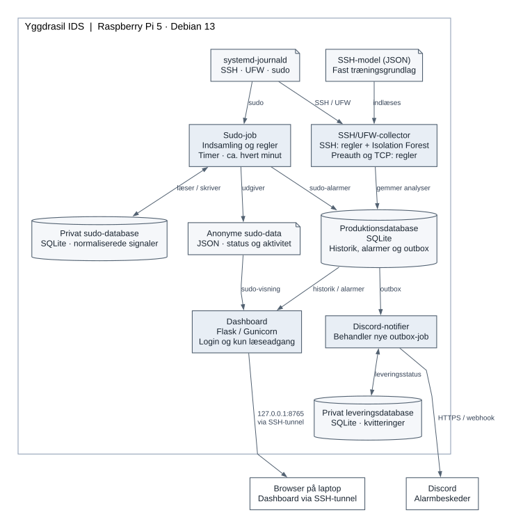

# Arkitektur

Yggdrasil IDS er ét produkt med adskilte driftsroller: løbende SSH/UFW-
indsamling, et periodisk sudo-job, et læsende dashboard og en Discord-notifier.
Rollerne deler konfiguration og alarmdatabase. Browserforespørgsler kan ikke
træne modeller, udføre systemkommandoer eller skrive kvitteringer i databasen.

## Komponenter og dataflow



*Figur 1. Journalposter behandles af en løbende collector og et periodisk
sudo-job. Alarmer samles i produktionsdatabasen og vises i dashboardet eller
sendes til Discord. Modellen bruges kun til SSH-autentificering.*

Rektangler med blå baggrund er driftsprocesser, cylindre er databaser, og
dokumentsymboler er journal- eller fildata. Pilene viser dataflow; en dobbeltpil
angiver læsning og skrivning. Rammen afgrænser komponenterne på Pi'en.
Browseren og Discord ligger uden for denne ramme. Figuren viser ikke hver
funktion eller hvert metodekald.

Outboxen er en tabel i produktionsdatabasen. Notifierens separate database
indeholder leveringsstatus. Webrollen har kun læseadgang og kan ikke åbne den
private sudo-database. Den viste modelfil indlæses af collector; der er ingen
automatisk træning fra de indsamlede hændelser. Firewall og Fail2ban er separate
værktøjer; IDS'en registrerer aktivitet og udsender alarmer.

### Driftsroller

| Proces | Konto | Opgave |
| --- | --- | --- |
| Collector | `yggdrasil-worker` | Læse SSH/UFW-journal, analysere og gemme resultater |
| Sudo-job | `yggdrasil-worker` | Periodisk privat indsamling, regler, alarmoverførsel og anonym eksport |
| Webserver | `yggdrasil-web` | Læse produktionsdata og sudo-eksporter; vise dashboardet |
| Notifier | `yggdrasil-notifier` | Læse outbox, levere beskeder og gemme leveringsstatus |

Collector og sudo-job kører som forskellige processer under samme worker-konto.
Sudo-timeren starter jobbet cirka ét minut efter den forrige kørsel er afsluttet.
Journalgrupper og filrettigheder er beskrevet i [SECURITY.md](SECURITY.md).

### Figur til rapporten

Figuren findes som [SVG](diagrams/architecture.svg) til skalering og
[PNG](diagrams/architecture.png) til indsættelse i et dokument. Brug teksten
under Figur 1 som udgangspunkt for billedteksten. Indsæt figuren i fuld
sidebredde, eventuelt som et bilag, så labels på pilene er læselige.
Diagrammet er en
komponent- og dataflowoversigt, ikke et formelt UML-diagram.

Den redigerbare kilde er [architecture.dot](diagrams/architecture.dot).
Figuren er lavet med [Graphviz](https://graphviz.org/documentation/), som
genererer diagrammer fra en tekstbeskrivelse. Med Graphviz installeret kan
eksporterne genskabes fra repositoryets rod:

```bash
dot -Tsvg docs/diagrams/architecture.dot -o docs/diagrams/architecture.svg
dot -Tpng -Gdpi=240 docs/diagrams/architecture.dot -o docs/diagrams/architecture.png
```

Graphviz er kun nødvendigt ved redigering af figuren og er ikke en
afhængighed for applikationen. Ved en ændring i komponenter eller dataflow
opdateres DOT-kilden og begge eksportfiler sammen.

## Ansvar og objektorientering

| Komponent | Ansvar |
| --- | --- |
| `JournalCollector` | Afgrænset læsning af SSH/UFW, journalposition, genoptagelse og heartbeat |
| `SSHParser`, `UFWParser`, `parse_preauth`, `parse_sudo` | Normalisere understøttede poster og afvise ugyldige eller uvedkommende input |
| `SSHRuleDetector`, `TCPPortScanDetector`, `SudoRuleDetector` | Vurdere eksplicitte regler med forklarlige grænser |
| `SSHFeatureBuilder` | Beregne den faste seksdimensionelle SSH-observation |
| `IsolationForestDetector` | Validere, indlæse og score den valgte SSH-model |
| `AnalysisEngine` | Samordne SSH/UFW-behandling med hændelsestid, model og transaktioner |
| `SudoStagingStore` og sudo-service | Privat normalisering, overlappende genlæsning, regeltilstand og offentlig eksport |
| `Repository` | Historik, observationsrækker, alarmgruppering, evidens, outbox, retention og backup |
| Flask-applikationen | Login, filtre og læsning af produktionshistorik og anonyme sudo-eksporter |
| `DiscordNotifier` | Læse nye outbox-referencer og gemme leveringsstatus separat |

Uforanderlige dataklasser, blandt andet `SSHEvent`, `Finding`, `FirewallEvent`
og `SudoSignal`, flytter veldefinerede data mellem lagene. Detektorerne udfører
ikke selv netværkskald eller webarbejde. Denne opdeling gør regler og features
testbare uden en levende journal eller Discord-forbindelse.

## Data og transaktioner

Produktionsdatabasen er schema5. SSH-historik, firewallhændelser, preauth-
evidens, sudo-evidens og alarmer er adskilte tabeller. En autentificering er
ikke en TCP-forbindelse; flere sudo-loglinjer kan beskrive samme proces.

SSH-kildepost, analyse og journalposition gemmes transaktionelt. Identiteter
bruges til deduplikering ved genlæsning og genstart. Forsinkede eller for langt
fremtidige hændelser kan gemmes uden at blive analyseret bagudrettet. En mistet
journalposition giver en synlig datamangelsadvarsel og genoptagelse med overlap.

Sudo-jobbet læser journalen med `--all` og filteret `_EXE=/usr/bin/sudo`.
Den private database gemmer kun kategorier og metadata til procesgruppering;
ingen rå kommandolinjer, brugernavne eller journalcursors. En ny kandidat
overføres som afgrænset evidens, alarm og outbox i samme destinationstransaktion.
Gentagne læsninger genbruger samme evidensidentitet. Den oprindelige
aktiveringsgrænse bevares ved opgradering, så gamle kandidater ikke bliver nye
alarmer. Den private schema2-checkpointtabel har et historisk navn af hensyn til
datakompatibilitet; der er ingen særskilt forsøgsfunktion i runtime.

Outboxens kildeidentitet og notifierens private leveringsdatabase overlever
opgraderingen. En ny alarmgruppe opretter et outbox-job; gentagne fund i samme
gruppe kan opdatere alarmen uden en ny besked for hvert fund. En outbox-række
alene beviser ikke, at Discord har kvitteret for levering.

## Tid, regler og ML

Vinduer beregnes fra hændelsestid i UTC, almindeligvis `(tid − vindue, tid]`.
Dashboardets danske tidszone ændrer kun visningen. SSH-regler og netværksregler
grupperer relevante poster pr. kilde og sensor; sudo tæller forskellige
processer pr. boot/proces-UID. UID er en intern grupperingsnøgle, ikke en
verificeret identitet for den person, der startede sudo.

SSH-modellens features er `failed_count`, `success_count`, `unique_users`,
`failure_ratio`, `hour_sin` og `hour_cos`. Preauth-poster bliver ikke gjort til
autentificeringer eller sendt ind i SSH-modellens features. Sudo og netværk
bruger heller ikke denne model.

Modellen scorer med `-score_samples`: højere score er mere afvigende. Et
resultat over den gemte tærskel kan blive et ML-fund med modelversion og
evidens. Det er ikke en sandsynlighed for et angreb. Tærsklens
`contamination`-parameter er ikke en målt angrebsrate.

Modelfilen er afgrænset JSON med fingerprint, featuredefinition, oprindelige
normale træningsobservationer og versionsoplysninger. Indlæsning genopbygger
skoven fra de gemte rækker med den samme scikit-learn-version og seed.
Nye livehændelser bruges ikke til automatisk træning eller tærskelændring.
Manuel modeludskiftning kræver gennemgået datagrundlag og bevidst aktivering.

## Dashboard og fejlsynlighed

Webrollen åbner produktions-SQLite skrivebeskyttet. Sudo vises gennem små,
validerede JSON-filer; webbrugeren kan ikke læse den private sudo-database.
Forældede eller ugyldige eksporter vises som utilgængelige, ikke som nul fund.
Manglende SSH-model skal være synlig og kan ikke bestå samlet produktionsaccept.

Menuens advarselstrekant angiver nye eller opdaterede registrerede alarmforløb
fra de sidste 24 timer, som browseren endnu ikke har set. Læstmarkeringer gemmes
lokalt i browseren. De sletter ikke historik og ændrer ikke Discord-levering.
