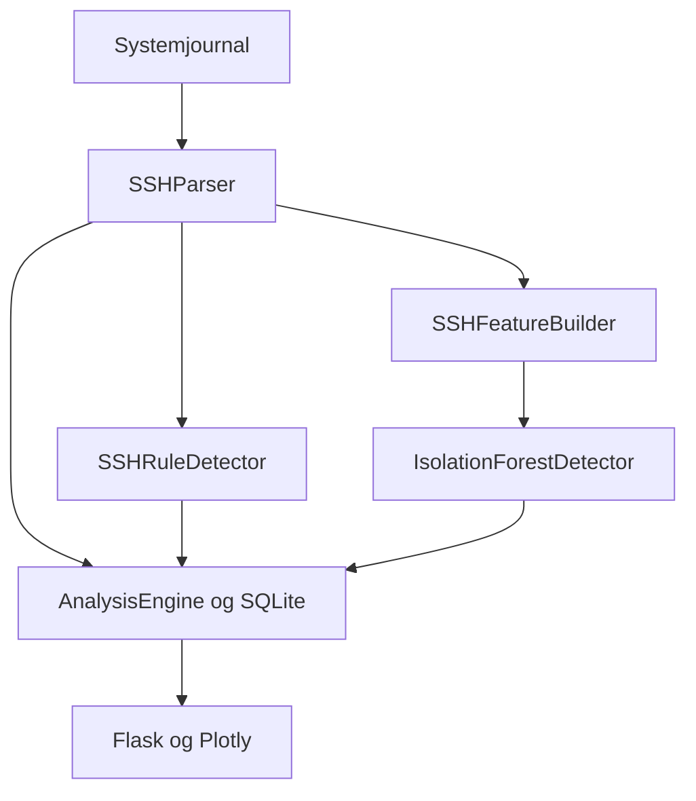

# Arkitektur · sprint 1

Yggdrasil IDS består af en collector og et privat dashboard. Collectoren kører
uafhængigt af browseren. Dashboardet læser de gemte resultater; HTTP-forespørgsler
kan hverken træne modeller eller udføre systemkommandoer.

## Ansvar og objektorientering

| Komponent | Ansvar |
| --- | --- |
| `JournalCollector` | Læse journalen, kontrollere adgang og genoptage fra en gemt position. |
| `SSHParser` | Oversætte en journalpost til højst ét autentificeringsresultat. |
| `SSHRuleDetector` | Anvende eksplicitte regler og forklare fund. |
| `SSHFeatureBuilder` | Beregne den faste numeriske featuredefinition. |
| `IsolationForestDetector` | Træne, validere, indlæse og vurdere en model. |
| `AnalysisEngine` | Samordne behandling og håndtere fejltilstande. |
| `Repository` | Transaktioner, historik, alarmer, læseposition og backup. |
| Flask-applikationen | Login, filtrering og læseadgang til historikken. |

De uforanderlige `SSHEvent`- og `Finding`-objekter overfører data mellem lagene.
Se [kildekoden](../src/yggdrasil_ids) og de målrettede [tests](../tests).

## Tid og tællinger

Vinduer beregnes ud fra hændelsestid i UTC: `(tid − vindue, tid]`, pr. kilde.
Hver autentificering udløser en vurdering. Fejlede autentificeringer er ikke et
antal TCP-forbindelser. PAM-sessionsposter og separate `Invalid user`-meddelelser
bliver ikke ekstra loginforsøg.

Kildepost, hændelse, analyse og journalposition gemmes i samme transaktion.
SQLite bruger `DELETE`-journaltilstand med korte transaktioner og ventetid ved
låsning, så dashboardets separate konto også kan læse databasen uden
skriverettighed, når collector er stoppet.
Gentagne kildeposter genkendes via deres identitet. Fund bevarer detektor og
modelversion, mens beslægtede fund grupperes til alarmforløb. Allerede behandlede
poster bliver ikke vurderet igen med en ny model ved genstart. Sammenligning af
andre modeller kræver en separat demo-database.

Forsinkede hændelser gemmes, men udelades fra den løbende analyse med synlig
status. Fremtidige driftshændelser over den tilladte urforskel behandles tilsvarende.
En mistet journalposition giver en advarsel om datamangler og genoptagelse med overlap.

## Model og forsøg

Features er antal fejl, succeser og brugernavne, fejlratio samt UTC-tidens sinus
og cosinus. Score er `-score_samples`: højere betyder mere afvigende. Den er ikke
en angrebssandsynlighed.

Træning er en manuel handling på gennemgået normalaktivitet. Utilstrækkelige eller
ensartede data afvises. Modellen gemmes som valideret JSON og genopbygges med samme
scikit-learn-version og seed; ingen pickle indlæses. Genstart af collectoren
aktiverer modellen. Labforsøgets træning, validering og afsluttende test består
af hele scenarier med tidsafstand større end to analysevinduer. Tærskler ændres
ikke efter testresultater; labels er uden for modelinput. Syntetiske resultater
viser programmets opførsel, ikke dokumenteret sikkerhed på en rigtig server.

## Kvalitet og videre udvikling

Unit tests dækker parser, tidsvinduer, regler og modelvalidering. Integrationstests
dækker blandt andet transaktioner, genstart, CLI og webadgang. Den faktiske
verifikation står i [VERIFICATION.md](VERIFICATION.md); rettigheder, logdækning
og ydeevne på målsystemet kontrolleres med [Pi-accepttesten](TEST_ON_PI.md).

Sprint 1 analyserer SSH. Discord-notifikationer er planlagt til sprint 2. Andre
hændelsestyper kræver egne datakilder, normalisering og evaluering; de eksisterende
SSH-features bliver ikke automatisk brugbare til netværkstrafik eller filændringer.
Se [roadmap](ROADMAP.md) for den aktuelle afgrænsning.
